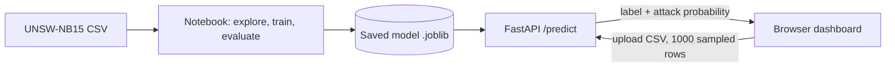

# NetGuard AI

A web app that uses machine learning to flag suspicious network connections and shows the alerts on a dashboard.

## Problem

Networks produce far more traffic than people can review, and fixed-rule tools such as Snort and Suricata can miss new attacks. NetGuard AI learns from labelled traffic which connections look like attacks. This is a learning project that builds the full pipeline end to end (data, model, API, dashboard, container). It is not meant to replace existing tools.

## How it works



## Results

Dataset: UNSW-NB15. Model: Random Forest (100 trees), trained on the 175,341-row file and evaluated on the separate 82,332-row file.

| Metric                         | Value                                 |
| ------------------------------ | ------------------------------------- |
| Accuracy                       | 0.87 (baseline "always attack": 0.55) |
| Attack precision / recall / F1 | 0.82 / 0.99 / 0.89                    |
| Normal precision / recall / F1 | 0.98 / 0.73 / 0.84                    |

Confusion matrix (rows = truth, columns = prediction):

|                 | Predicted normal | Predicted attack |
| --------------- | ---------------- | ---------------- |
| Actually normal | 27,019           | 9,981            |
| Actually attack | 667              | 44,665           |

The model catches about 98.5% of attacks but wrongly flags about 27% of normal traffic.

## Tech stack

Python, pandas, scikit-learn, FastAPI, plain JavaScript with Chart.js, Docker.

## Run it

1. Clone the repo, create a venv, and run `pip install -r requirements.txt`.
2. Download UNSW-NB15 (training and testing CSVs) into `ml/data/`.
3. Run `ml/notebooks/01_explore.ipynb` top to bottom. This trains the model and writes it to `ml/models/`.
4. Build and start the app:

```bash
docker build -t netguard-ai .
docker run --rm -p 8080:8000 -v "$(pwd)/ml/models:/app/ml/models:ro" netguard-ai
```

5. Open http://127.0.0.1:8080 and upload a UNSW-NB15 CSV.

The model file (about 108 MB) is not in the repo because it is git-ignored and too large for GitHub.

## Limitations

- **False alarms:** about 27% of normal connections are flagged as attacks, which would overwhelm a real analyst.
- **Dataset:** UNSW-NB15 is lab-generated data from 2015. Results may not carry over to live traffic.
- **Distribution shift:** the two data files differ in their attack share (68% against 55%), which probably contributes to the false alarms. Not yet investigated.
- **Batch only:** it analyses uploaded CSV files. There is no live packet capture.
- **Rare attack types:** per-attack-type results (for example Worms, Shellcode) have not been evaluated.
- **Not done yet:** Isolation Forest (unsupervised) comparison, public cloud deployment, API authentication.
- **Feature caution:** the most important features (such as TTL values) may reflect how the dataset was generated and not real attack behaviour.
